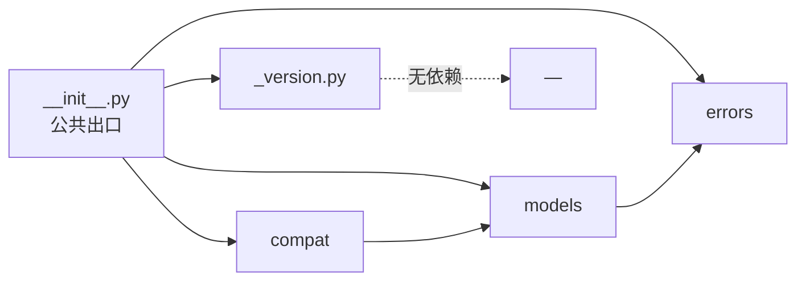

# 架构

> 状态：初始骨架 ｜ 最后核对：2026-11-18 ｜ 对应提交：初始版本

## 1. 上下文

这个库的调用方是**其他 Python 代码**，不是终端用户，也不是前端。因此没有请求生命周期，
没有接口契约，只有一条条函数调用。架构要回答的问题不是「请求怎么流经四层」，
而是「哪个模块可以被 import、改动会波及到谁」。

## 2. 模块职责

| 模块 | 职责 | 对外可见 |
| --- | --- | --- |
| `__init__.py` | 唯一公共出口，`__all__` 即契约 | 是（全部） |
| `_version.py` | 版本单一真源，构建时被读取 | 仅 `__version__` |
| `errors.py` | 异常层次，供调用方精确捕获 | 是 |
| `models.py` | `Version` 值对象、解析、排序 | 是 |
| `compat.py` | 兼容性判断，唯一有分支的业务逻辑 | 是 |

## 3. 依赖方向

规则只有一条：**依赖单向、无环**。`models` 不认识 `compat`，`errors` 不认识任何模块。
库比服务更容易出现循环依赖，因为没有中间层帮你打断——一旦形成环，`import` 顺序就会变成隐式契约。

## 4. 关键设计决策

| 决策 | 理由 | 代价 |
| --- | --- | --- |
| `Version` 是 `frozen` + `slots` 的 dataclass | 值对象要被当作字典键，必须不可变且可哈希 | 不能原地修改，只能新建实例 |
| 不引入 pydantic | 库的默认依赖应尽量为空；pydantic 会把它的校验语义强加给下游 | 参数校验要手写，但只写真正需要的那几条 |
| 不配置日志 | 库调用 `logging.basicConfig()` 会覆盖宿主程序的日志设置，是经典的库反模式 | 库内不可观测，问题排查依赖异常信息 |
| 不定义 `Protocol` / 抽象基类 | 目前每种角色只有一个实现，单实现的抽象是纯成本 | 未来真要替换实现时需要一次重构 |
| 版本只在 `_version.py` 写一次 | 两处写必然漂移，`pip show` 与 `__version__` 对不上的 bug 极难排查 | 构建时需要 `setuptools.dynamic` 读取，多一层解析 |
| 预发布后缀允许出现但不参与排序 | 跨生态的预发布排序规则并不一致，强行实现会给出错误结论 | `1.0.0-rc.1` 与 `1.0.0` 被视为相等，见 tech-debt |

## 5. 稳定性边界

| 属于公共契约 | 属于实现细节 |
| --- | --- |
| `__all__` 列出的名字 | `_version.py` 的模块名本身（只承诺 `__version__`） |
| 上述名字的签名、返回值类型 | 任何以 `_` 开头的成员 |
| 异常类型与继承关系 | 异常消息的具体文案 |
| `Version` 的比较语义 | `_sort_key` 的实现方式 |

改了右边一列不算破坏性变更，改了左边一列必须升主版本并走弃用流程。

## 6. 非目标

- 不做版本范围表达式（`>=1.2,<2.0`）——那是另一个库的领域，混进来会让本库的语义变模糊。
- 不解析 `v1.2.3` 前缀——接受它等于默许两种写法，下游会各写各的。
- 不做依赖解析（pip 的活）。

## 7. ADR 索引

库型骨架初期不建 `adr/` 目录：决策密度低，上表足够。出现以下情况时再建：

- 决定支持 Python 3.9（会失去 `slots` 与 `X | None`）；
- 决定引入第一个运行时依赖；
- 决定改变版本的排序语义。
