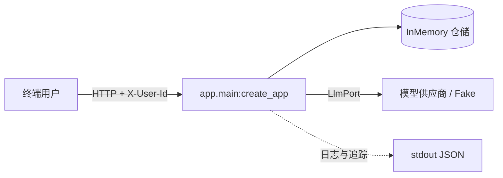
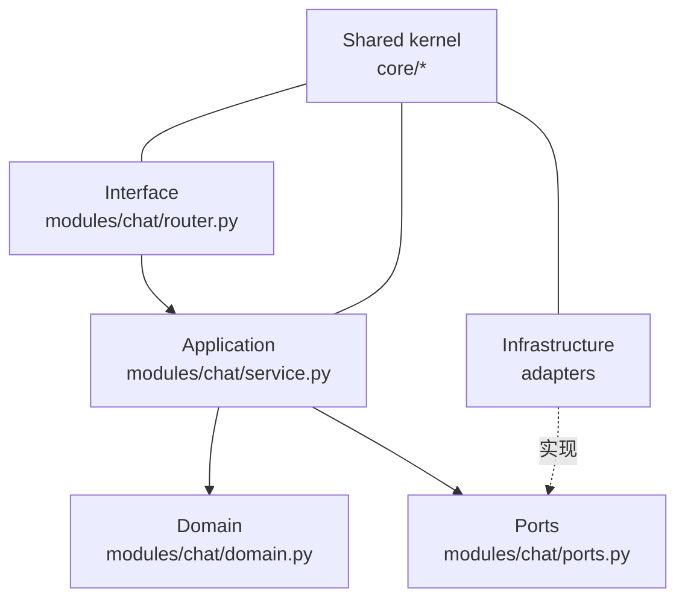

> 状态：可用｜最后核对：2026-11-18｜对应提交：未提交

# 架构现状

## 1. 系统一句话

HTTP 请求进入 `main.py` 装配的 FastAPI 应用，经追踪中间件后由 `modules/chat/router.py` 接收，
交给 `ChatService` 编排领域对象与两个端口（仓储、模型），端口由 `infrastructure/` 下的适配器实现。

## 2. 上下文

当前没有前端、没有数据库、没有消息队列。三者都是**预留接缝**，不是遗漏。

## 3. 分层与依赖方向

| 调用方 ↓ / 被调方 → | Interface | Application | Domain | Infrastructure |
| --- | --- | --- | --- | --- |
| Interface | — | ✅ | ✅ 只读视图 | ❌ |
| Application | ❌ | 谨慎 | ✅ | ✅ 仅通过端口 |
| Domain | ❌ | ❌ | ✅ | ❌ |
| Infrastructure | ❌ | ❌ | ✅ 实现端口 | ✅ |

`core/` 是共享内核（配置、日志、异常、错误码、响应信封、幂等存储、限流器），四层都可依赖它；它不依赖任何业务模块。`Envelope` 之所以放在这里而不是某个域里，是因为每个域都要返回它——放在域内会迫使其他域跨域 import。
唯一例外是 `main.py`（组合根）：它允许直接 import 具体路由与适配器，这是装配职责。

## 4. 模块清单

| 模块 | 路径 | 职责 | 对外 API | 依赖 |
| --- | --- | --- | --- | --- |
| chat | `backend/app/modules/chat/` | 会话与消息的领域规则、用例、HTTP 契约 | `ChatService`、`ChatSession`、`router` | `core`、`ports` |
| core | `backend/app/core/` | 配置、日志、异常、错误码、响应信封、幂等与限流、健康检查、追踪 | `Settings`、`AppError`、`Envelope`、`TokenBucketLimiter` | 无 |
| infrastructure.persistence | `backend/app/infrastructure/persistence/` | 实现 `ChatSessionRepository` | `InMemoryChatSessionRepository` | `modules.chat.ports` |
| infrastructure.llm | `backend/app/infrastructure/llm/` | 实现 `LlmPort` | `FakeLlmAdapter`、`OpenAiAdapter` | `modules.chat.ports` |
| 组合根 | `backend/app/container.py`、`main.py`、`dependencies.py` | 装配端口、注册中间件与异常处理器 | `create_app()` | 全部 |

chat 模块内部文件职责：

| 文件 | 层 | 说明 |
| --- | --- | --- |
| `domain.py` | Domain | `ChatSession` 聚合根、`ChatMessage` 值对象、领域异常、不变量 |
| `ports.py` | Application 契约 | `LlmPort`、`ChatSessionRepository`，纯 `Protocol` |
| `service.py` | Application | 用例编排、归属校验、轮次上限、乐观锁 |
| `schemas.py` | Interface | Pydantic 请求/响应模型（`Envelope` 已上提到 `core/schemas.py`） |
| `router.py` | Interface | 四个端点，只做协议转换 |

## 5. 横切关注点落点

| 关注点 | 落点 | 说明 |
| --- | --- | --- |
| 配置 | `core/config.py` | `Settings` 冻结、`extra="forbid"`、启动即校验 |
| 日志 | `core/logging.py` | JSON / 文本两种格式，字段固定，含 `trace_id` |
| 脱敏 | `core/logging.py::redact` | 在 handler 出口统一替换凭据、手机号、邮箱 |
| 异常 | `core/errors.py` | `AppError` 层级，HTTP 状态由业务码 `//100` 推导 |
| 错误码 | `core/error_codes.py` | `http_status * 100 + 序号`，前端按数字分支 |
| 响应信封 | `core/schemas.py` | 所有端点共用一个形状，前端只写一个解析器 |
| 幂等 | `core/idempotency.py` | `IdempotencyStore` 端口 + 内存实现，带 TTL 清理 |
| 限流 | `core/rate_limit.py` | 令牌桶，支持突发与匀速补充，空闲桶自动回收 |
| 追踪 | `core/middleware.py` | 生成或透传 `X-Trace-Id`，写入响应头与日志 |
| 装配 | `container.py` | 唯一知道具体适配器的地方 |

## 6. 关键约束

- `domain.py` **不导入** fastapi / pydantic / httpx，可脱离框架单测。
- `router.py` **不碰**仓储与模型端口，只依赖 `ChatService`。
- `service.py` **不拼**查询、**不 import** 供应商 SDK。
- 换模型供应商 = 新增 adapter + 改 `container._build_llm` 一行；不改业务代码。
- 换存储 = 新增 repository 实现 + 改 `container.build_container` 一行。

## 7. 边界与「不做的事」

- 不做多租户隔离：当前 `owner_id` 是单层身份，没有 tenant 维度。
- 不做流式输出：`LlmPort.complete` 是一次性返回，SSE 需要新增端口方法。
- 不做跨进程锁：乐观锁只在单进程内存仓储内有效，换库后依赖数据库版本列。
- 不做插件化：没有 entry-point 动态加载，模块在 `main.py` 静态注册。

## 8. ADR 索引

| 编号 | 标题 | 状态 |
| --- | --- | --- |
| [0001](adr/0001-four-layer-modular-monolith.md) | 分层模块化单体，按业务域切包 | 已采纳 |
| [0002](adr/0002-ports-and-adapters.md) | 端口与适配器隔离存储和模型供应商 | 已采纳 |
