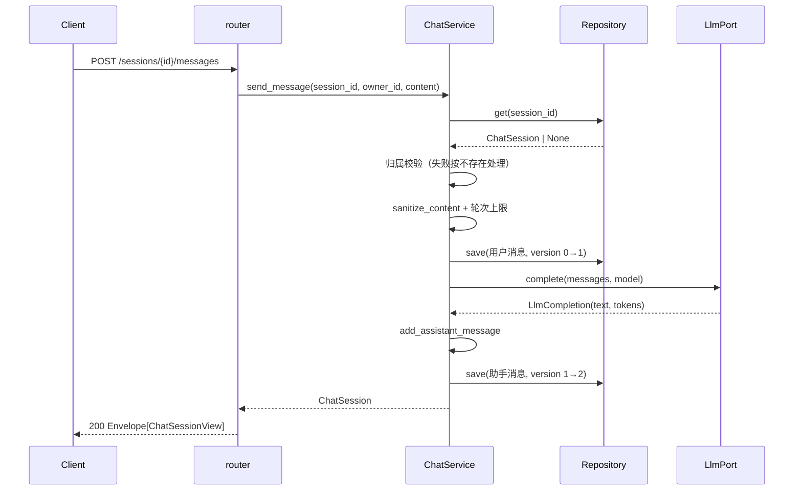
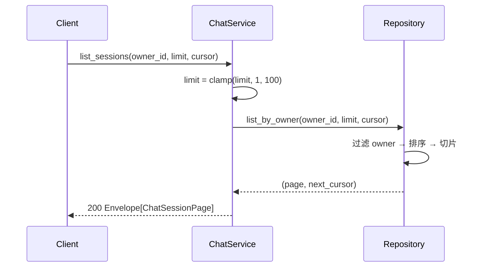
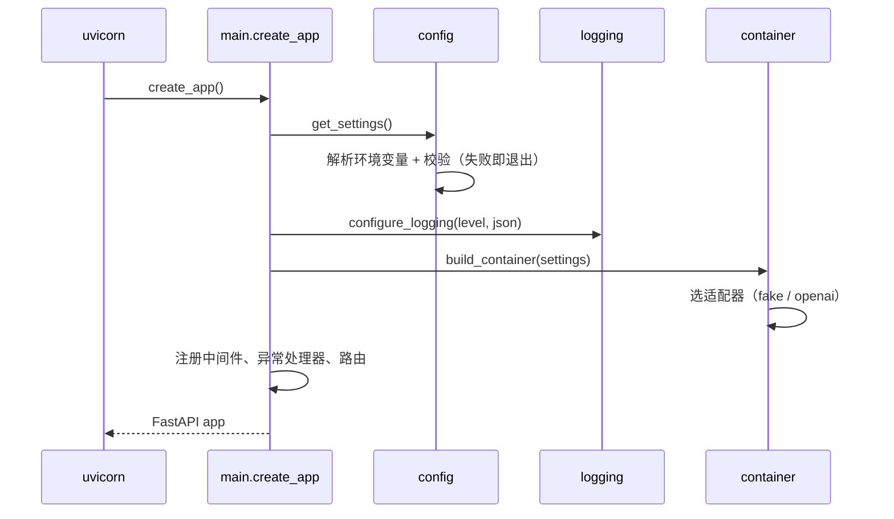

> 状态：可用｜最后核对：2026-11-18｜对应提交：未提交

# 主要数据流

只记录主干链路。接口清单以 `/openapi.json` 为准，此处解释**顺序、失败与副作用**。

## DF-1 发送消息并生成回复

| 项 | 内容 |
| --- | --- |
| 触发 | `POST /api/v1/chat/sessions/{session_id}/messages` |
| 入口 | `modules/chat/router.py::send_message` |
| 参与者 | Router → ChatService → Repository / LlmPort → Adapter |
| 幂等 | **无**。重复提交会产生两轮对话（tech-debt #2） |
| 数据留存 | 会话与消息驻留内存；日志输出 stdout，按采集端策略留存 |

**失败与补偿**

| 失败点 | 表现 | 已落库状态 | 处理 |
| --- | --- | --- | --- |
| 会话不存在或非本人 | 404 `40401` | 无变化 | 统一文案，防枚举 |
| 内容为空 / 超长 | 400 `40001` | 无变化 | 返回字段位置 |
| 轮次达到上限 | 409 `40901` | 无变化 | 提示新建会话 |
| 模型调用失败 | 502 `50201` | **用户消息已保存** | 客户端可重试同一内容 |
| 模型返回空文本 | 502 `50201` | 用户消息已保存 | 同上 |
| 保存时版本冲突 | 409 `40900` | 先写者生效 | 客户端重取后重试 |

**为什么先存用户消息**：模型不可用时，用户输入不应丢失。代价是可能出现「有提问没回答」的半个回合，
由前端在重试时复用最后一条用户消息，而不是重新插入。

**可观测点**：`chat_session_created`、`llm_completion`（含 token 用量）、`http_request`（含耗时与状态）。

## DF-2 列出会话（游标分页）

| 项 | 内容 |
| --- | --- |
| 触发 | `GET /api/v1/chat/sessions?limit=20&cursor=<token>` |
| 入口 | `modules/chat/router.py::list_sessions` |
| 参与者 | Router → ChatService → Repository |
| 幂等 | 只读，天然幂等 |
| 分页 | 按 `updated_at` 倒序；`limit` 被钳制在 `[1, 100]` |

**失败与补偿**

| 失败点 | 表现 | 处理 |
| --- | --- | --- |
| `cursor` 非十进制 | 400 `40001` | 视为非法令牌，不静默回到第一页 |
| `limit` 越界 | 400 `40001` | 查询参数已声明 `ge=1, le=100` |
| 缺少身份 | 401 `40101` | 非 dev 环境必须带 `X-User-Id` |

**已知偏差**：内存实现把游标实现为偏移量，翻页期间有写入会重复或漏项。换成数据库后应改为
`(updated_at, session_id)` 复合游标（见 tech-debt #4）。

## DF-3 应用启动与配置装载

| 项 | 内容 |
| --- | --- |
| 触发 | `uvicorn app.main:create_app --factory` |
| 入口 | `main.py::create_app` |
| 参与者 | Settings → configure_logging → build_container → FastAPI |
| 幂等 | 每次进程启动一次；重复调用会重建 handler 与容器 |

**失败与补偿**

| 失败点 | 表现 | 处理 |
| --- | --- | --- |
| 必填配置缺失（openai 无 key） | 启动即抛 `ConfigurationError` | 进程退出，不带病运行 |
| 环境变量拼错 | `extra="forbid"` 拒绝 | 同上 |
| 日志级别非法 | `ValueError` | 同上 |

**为什么校验放在启动**：配置错误在第一个真实请求才暴露，通常发生在半夜。
