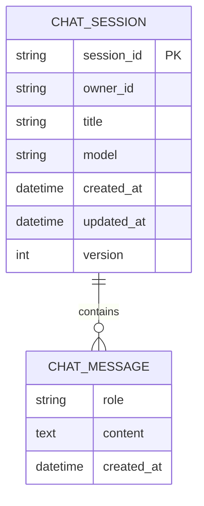
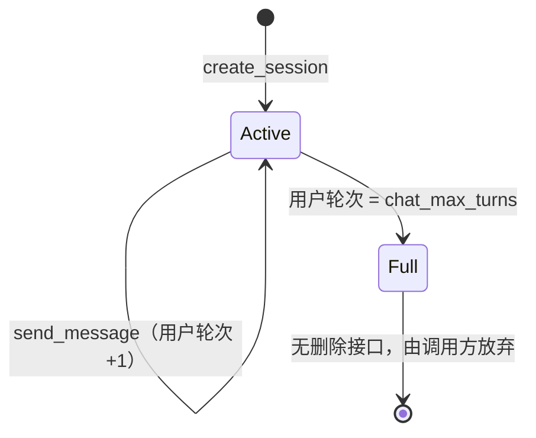

> 状态：可用｜最后核对：2026-11-18｜对应提交：未提交

# 实体模型

当前只有一个聚合：会话。所有实体为纯 Python 对象，不依赖 ORM。

## 实体清单

| 实体 | 类型 | 代码位置 | 持久化 | 生命周期 |
| --- | --- | --- | --- | --- |
| `ChatSession` | 聚合根 | `modules/chat/domain.py` | 内存字典（待换库） | 创建 → 追加消息 → 达到轮次上限 |
| `ChatMessage` | 值对象（不可变） | 同上 | 随聚合整体保存 | 随会话，不单独修改 |
| `LlmCompletion` | 值对象（不可变） | `modules/chat/ports.py` | 不持久化 | 单次调用内 |

## 关系

一个会话拥有 0..N 条消息，消息不独立寻址；删除会话即删除其消息（当前无删除接口）。

## ChatSession（聚合根）

| 字段 | 类型 | 约束 | 语义 |
| --- | --- | --- | --- |
| `session_id` | `str` | 32 位十六进制，唯一 | `uuid4().hex`，创建时生成 |
| `owner_id` | `str` | 去空白后非空 | 资源级权限的唯一依据 |
| `title` | `str` | 去空白后 1–120 字符 | 展示用，不参与业务判断 |
| `model` | `str` | 去空白后 1–64 字符 | 本会话所有补全使用的模型 |
| `created_at` | `datetime` | 必须带时区 | 创建时刻，创建后不变 |
| `updated_at` | `datetime` | 带时区且 ≥ `created_at` | 最后一次被接受变更的时刻 |
| `messages` | `list[ChatMessage]` | 有序，最早在前 | 只通过方法追加 |
| `version` | `int` | 单调递增 | 乐观锁令牌，每次保存 +1 |

**不变量**（违反抛 `ValidationError`，或 `ChatTurnLimitExceededError`）

1. `owner_id` / `model` / `session_id` 去空白后非空。
2. `title` 去空白后非空且 ≤ 120 字符（超长不截断，直接拒绝）。
3. `created_at`、`updated_at` 必须带时区；`updated_at` 不得早于 `created_at`。
4. `touch()` 不得把 `updated_at` 往回拨。
5. 用户轮次数量 ≤ `Settings.chat_max_turns`（默认 40），在追加前检查。
6. `ChatMessage.content` 去空白后非空；`ChatMessage.created_at` 必须带时区。

**状态机**

`Full` 状态下 `add_user_message` 抛 `ChatTurnLimitExceededError`（409 / `40901`），
聚合本身不变，已有消息仍可读。

**谁能改它**

只有聚合自身的方法：`add_user_message`、`add_assistant_message`、`touch`。
`ChatService` 不得直接操作 `messages` 或字段；仓储返回的是深拷贝，改副本不影响存储。

## ChatMessage（值对象）

| 字段 | 类型 | 约束 | 语义 |
| --- | --- | --- | --- |
| `role` | `MessageRole` | `user` / `assistant` | 不存 system；系统提示由适配器组装 |
| `content` | `str` | 去空白后非空，长度由 settings 收口 | 已清洗的正文 |
| `created_at` | `datetime` | 必须带时区 | 该轮被接受的时刻 |

不可变（`frozen=True`）。修改一条消息的唯一方式是追加新消息。

## LlmCompletion（端口返回值）

| 字段 | 类型 | 语义 |
| --- | --- | --- |
| `text` | `str` | 供应商返回的正文，已去空白 |
| `prompt_tokens` | `int` | 计费口径的输入 token，未知时为 0 |
| `completion_tokens` | `int` | 计费口径的输出 token，未知时为 0 |

## 持久化映射

| 领域对象 | 存储形态 | 说明 |
| --- | --- | --- |
| `ChatSession` | `dict[str, ChatSession]`，键为 `session_id` | 值存深拷贝 |
| `ChatMessage` | 内嵌于会话对象 | 无独立表 |
| 并发控制 | `version` 字段比对 | 不一致抛 `ConflictError`（409 / `40900`） |

换成关系库时：会话一张表，消息一张表加 `(session_id, ordinal)` 唯一约束；
`version` 映射为整型列并在 `UPDATE ... WHERE version = ?` 中比对。
