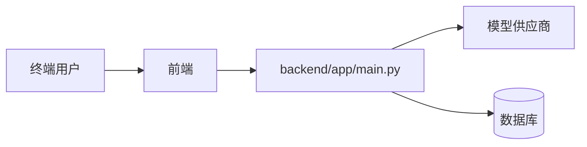
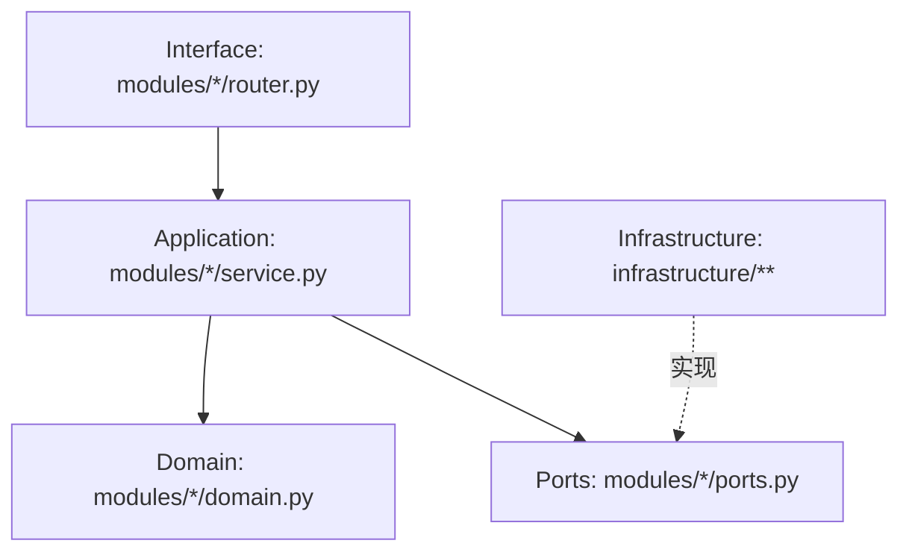
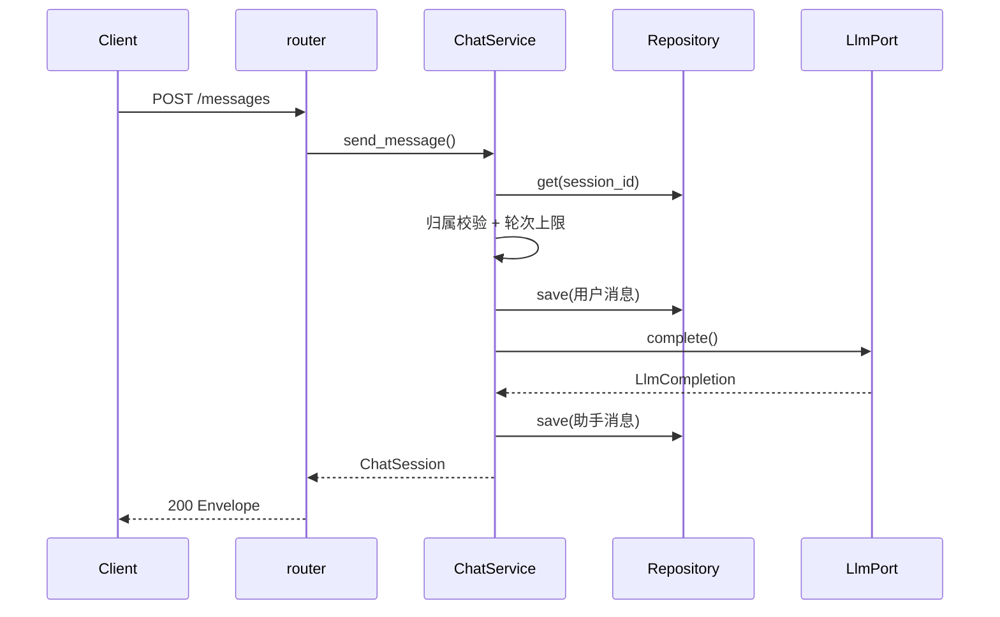
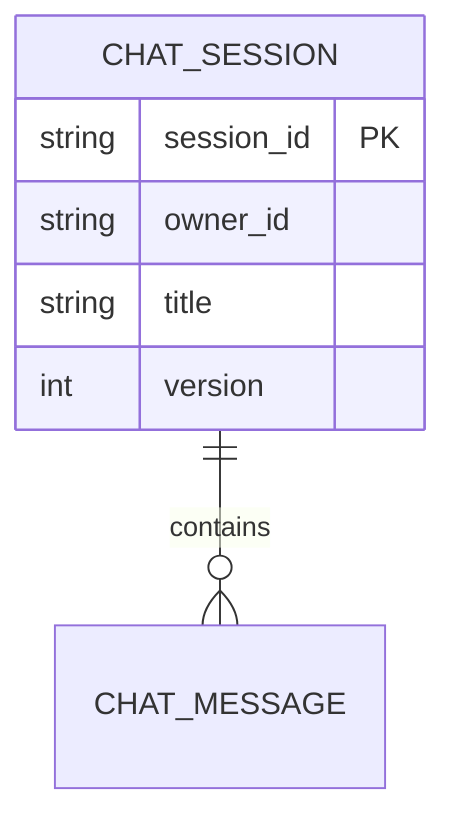
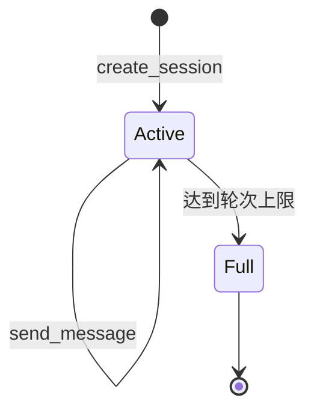

# 04 · 交接文档规范（Documentation & Handover）

> 前三分规范管「代码怎么写」「结构怎么切」「质量怎么保」，本文件管**知识怎么留下来**。
> 适用场景：多个模型 / 多个 Agent 在不同时间接力开发同一仓库，同时人类用户要能随时接管判断方向。

约定级别：**MUST** / **SHOULD** / **MAY**，含义同《01 · 代码风格规范》。

---

## 0. 这份规范要解决的问题

Vibe Coding 的失效点不在写代码，在**上下文断裂**。具体有三种：

| 失效模式 | 现场表现 | 后果 |
| --- | --- | --- |
| 状态丢失 | 新会话的 Agent 不知道上次做到哪、哪些是刻意为之 | 重复实现、推翻已定方案、把 bug 当特性保留 |
| 决策丢失 | 代码在，理由没了 | 后人「优化」掉必要的妥协，或不敢动一段没人懂的代码 |
| 人类失速 | 用户只能看 diff，无法判断方向对不对 | 评审退化为橡皮图章，出问题才发现跑偏 |

对应的三类文档，职责必须分清，不能混在一份「设计文档」里：

- **状态文档**（README、architecture）——**现在是什么样**；
- **决策文档**（ADR）——**为什么是这样，不是那样**；
- **变更文档**（dev-log）——**什么时候、被谁、改成了什么样**。

一条硬规则：**文档描述现状，不描述计划**。计划写在 issue / PR 里，文档只记录已发生的事实与已生效的约束。

---

## 1. 文档地图

所有交接文档位于仓库 `docs/`，只允许下列位置，禁止另起炉灶：

```
docs/
├── README.md            # 项目快照与文档索引（人类 30 秒入口）
├── architecture.md      # 架构、模块清单、依赖方向、ADR 索引
├── data-flow.md         # 主要数据流：入口到落库、失败与补偿
├── entities.md          # 实体模型：字段、关系、不变量、状态机
├── ux.md                # 末端用户交互：旅程、界面状态、错误文案
├── dev-log.md           # 开发记录：一个 PR 一条，倒序
├── tech-debt.md         # 技术债登记（格式见 02 第 15 节）
├── runbook.md           # 部署、回滚、常见故障（上线前必须有）
└── adr/
    ├── 0001-four-layer-modular-monolith.md
    └── 0002-ports-and-adapters.md
```

| 文件 | 回答的问题 | 主要读者 | 更新触发 | 体量上限 |
| --- | --- | --- | --- | --- |
| `README.md` | 这是什么？能跑吗？下一步做什么？ | 人类、新 Agent | 能力、启动方式、状态变化 | 120 行 |
| `architecture.md` | 代码在哪一层？改这个功能该动哪里？ | Agent、新成员 | 新增/删除模块、分层调整 | 250 行 |
| `data-flow.md` | 一次请求经过哪些环节？失败会怎样？ | Agent、排障者 | 新增/修改主链路 | 每流 60 行 |
| `entities.md` | 有哪些核心对象？哪些状态非法？ | Agent、前后端 | 实体/字段/不变量变化 | 250 行 |
| `ux.md` | 用户看到什么？出错时看到什么？ | 产品、前端、人类 | 交互或文案变化 | 200 行 |
| `dev-log.md` | 最近改了什么？为什么？ | 所有人 | 每个合并的 PR | 只增不删 |
| `adr/NNNN-*.md` | 当时为什么这样选？ | 后人、评审 | 跨模块技术决策 | 80 行 |

**MUST** 其他文档（需求稿、调研、会议记录）放 `docs/notes/`，且必须在 `README.md` 索引里登记；未登记的文档视为不存在。

**MAY** 使用非 Markdown 补充材料（架构图源文件、接口样例 `.http`、数据字典 `.csv`），但**结论必须落在 `.md` 里**——二进制与截图无法被 diff、无法被 Agent 检索。

---

## 2. 通用写作规则

### 2.1 内容规则（MUST）

1. **MUST** 每条事实可核对：写清路径、命令、接口、错误码，不写「大概在 service 层」。
2. **MUST** 写「约束与理由」，不写「代码翻译」。`UserService 负责用户` 是废话；`配额校验必须在 service 层，因为 router 层拿不到事务` 才是信息。
3. **MUST** 与代码同 PR 更新。**禁止**「先合代码，文档下次补」——下次不会来。
4. **MUST** 图用 Mermaid，节点名与代码中的模块 / 类 / 表名**逐字一致**，禁止自创别名。
5. **MUST** 文档头部标注元信息：状态、最后核对日期、对应提交。三者缺一，读者无法判断可信度。
6. **MUST NOT** 复制超过 15 行的代码。指路（`路径:行号` 或符号名）+ 说明意图即可，代码会变，副本不会。
7. **MUST NOT** 写「待补充」「后续完善」占位。要么写，要么登记进 `tech-debt.md`。
8. **MUST NOT** 用「应该 / 大概 / 可能」描述现状。不确定就标 `⚠️ 未验证`，并写清验证方法。

### 2.2 形式规则（SHOULD）

- 一节不超过 60 行，超了拆小节——长文没人读完，Agent 也容易被截断。
- 表格优先于段落：字段、错误码、模块、状态迁移天然是表格。
- 时间统一 `YYYY-MM-DD`，跨时区场景附 UTC 时间戳。
- 正文中文，标识符、路径、命令、错误码保持英文原样。
- 术语首次出现给一句定义；同一概念只用一个词（不要「会话 / 对话 / session」混用）。

### 2.3 元信息块模板（所有文档开头必填）

```markdown
> 状态：可用（dev 环境）｜最后核对：2026-11-18｜对应提交：a1b2c3d
```

- **状态**取值固定：`草稿` → `可用` → `过时`。`过时` 的文档必须在一周内修正或删除。
- **最后核对**是该文档内容被**逐条确认**的日期，不是修改日期。改了错别字不算核对。
- **对应提交**写短 SHA；没有 commit 的新项目写 `未提交`。

---

## 3. 模板

### 3.1 `docs/README.md` —— 项目快照

读者只有 30 秒，首屏必须回答：这是什么、能不能跑、下一步做什么。

```markdown
> 状态：可用（dev）｜最后核对：2026-11-18｜对应提交：a1b2c3d

# <项目名>

一句话定位：<给谁、解决什么问题、当前形态>。

## 现在能做什么

| 能力 | 状态 | 入口 | 备注 |
| --- | --- | --- | --- |
| 创建会话并对话 | ✅ 可用 | `POST /api/v1/chat/sessions` | 使用 fake 模型适配器 |
| 真实模型接入 | 🚧 未验证 | `AI_ASSISTANT_LLM_PROVIDER=openai` | 需供应商密钥 |

## 怎么跑起来

```bash
python -m venv .venv && .venv/Scripts/python -m pip install -e ".[dev]"
cp .env.example .env
cd backend && uvicorn app.main:create_app --factory --reload
```

## 目录导航

| 路径 | 内容 |
| --- | --- |
| `backend/app/core/` | 配置、日志、异常、错误码 |
| `backend/app/modules/chat/` | 会话域四层样板 |
| `docs/` | 交接文档，从 `architecture.md` 读起 |

## 文档索引

- [架构](architecture.md) ｜ [数据流](data-flow.md) ｜ [实体](entities.md)
- [用户交互](ux.md) ｜ [开发记录](dev-log.md) ｜ [ADR](adr/)
- [技术债](tech-debt.md) ｜ [运维手册](runbook.md)

## 最近三次变更

1. 2026-11-18 `feat(chat)` 会话域四层样板落地 —— [dev-log](dev-log.md#2026-11-18)
2. …

## 已知限制

- 内存仓储，重启即丢数据（见 ADR-0002）。
- 未接入鉴权服务，`X-User-Id` 为临时身份（见 tech-debt）。
```

规则：

- **MUST** 「现在能做什么」用状态标记：`✅ 可用` / `🚧 未验证` / `⛔ 停用`。不要用「基本完成」这种无法判定的词。
- **MUST** 启动命令可直接复制执行，且经过最近一次核对。
- **MUST** 已知限制如实写。隐藏限制会让下一个人重踩同一个坑。

### 3.2 `docs/architecture.md` —— 架构现状

```markdown
> 状态：可用｜最后核对：2026-11-18｜对应提交：a1b2c3d

## 1. 系统一句话

<请求从哪来、经过哪些层、落到哪>。

## 2. 上下文



## 3. 分层与依赖方向



| 调用方 ↓ / 被调方 → | Interface | Application | Domain | Infrastructure |
| --- | --- | --- | --- | --- |
| Interface | — | ✅ | ✅ | ❌ |
| Application | ❌ | 谨慎 | ✅ | ✅ 仅通过端口 |
| Domain | ❌ | ❌ | ✅ | ❌ |
| Infrastructure | ❌ | ❌ | ✅ 实现端口 | ✅ |

## 4. 模块清单

| 模块 | 路径 | 职责 | 对外 API | 依赖 |
| --- | --- | --- | --- | --- |
| chat | `backend/app/modules/chat/` | 会话与消息 | `ChatService`、`router` | core、ports |

## 5. 横切关注点落点

| 关注点 | 落点 | 说明 |
| --- | --- | --- |
| 配置 | `core/config.py` | `Settings` + `get_settings()`，启动即校验 |
| 日志 | `core/logging.py` | JSON + trace_id + 脱敏 |
| 异常 | `core/errors.py` | `AppError` 层级，状态码由业务码推导 |
| 追踪 | `core/middleware.py` | 请求级 trace_id，写入响应头 |

## 6. 边界与「不做的事」

- 不做多租户隔离（当前单用户模型）。
- 不做流式输出（见 ADR-0003 待定）。

## 7. ADR 索引

| 编号 | 标题 | 状态 |
| --- | --- | --- |
| [0001](adr/0001-four-layer-modular-monolith.md) | 分层模块化单体 | 已采纳 |
```

规则：

- **MUST** 模块清单与仓库目录**一一对应**。新增模块必须在此登记，删除模块必须在此划掉并写明替代。
- **MUST** 调用矩阵与《02》第 2.2 节保持一致；不一致时先改代码或先改 02，不允许两套说法并存。
- **SHOULD** 只画 1 张上下文图 + 1 张分层图。架构图超过 3 张说明没抓住主线。

### 3.3 `docs/adr/NNNN-kebab-title.md` —— 架构决策记录

命名：四位编号 + 短横线小写标题，如 `0007-use-sse-for-streaming.md`。**编号永不复用**，废弃也保留文件。

```markdown
# ADR-0007 使用 SSE 而非 WebSocket 输出流式回复

> 状态：已采纳｜日期：2026-11-18｜决策者：<角色>｜关联：PR #128、DF-1

## 背景

<约束是什么：需求、流量、团队规模、合规、时间窗>。不写解决方案。

## 决策

<一句话结论>，以及它具体意味着什么（代码落点、接口形态）。

## 备选方案

| 方案 | 优点 | 代价 | 结论 |
| --- | --- | --- | --- |
| SSE | 单向、可走 HTTP/1.1、断线重连简单 | 不支持双向 | 采纳 |
| WebSocket | 全双工 | 需要独立网关与心跳治理 | 不采纳 |

## 后果

- 正面：<获得什么>
- 负面：<付出什么，必须诚实>
- 风险：<什么情况下会后悔，触发条件是什么>

## 验证方式

<怎么证明这个决策生效：指标、测试、代码检查点>。

## 相关

<关联 ADR、模块、文档章节>
```

状态机（**MUST** 只使用这四个值）：

```
提议中 ──采纳──> 已采纳 ──被取代──> 已取代（指向新 ADR）
   └──放弃──> 已放弃            └──不再适用──> 已废弃
```

规则：

- **MUST** 一个 ADR 只记一个决策。把「选框架 + 定分层 + 定日志格式」塞进一篇，等于没记。
- **MUST** 「备选方案」至少写一个被否决的方案及原因，否则读者无法判断是否已充分比较。
- **MUST** 「后果」里的负面项不得为空。全是优点的 ADR 通常是没想清楚。
- **MUST** 决策被推翻时新建 ADR 并把旧的标记为 `已取代`，**禁止**直接改旧 ADR 的结论（历史必须可追溯）。

### 3.4 `docs/data-flow.md` —— 主要数据流

每条流一个编号 `DF-<n>`，编号稳定不复用。只记录**主干链路**（3–5 条），不为每个接口写一条。

```markdown
## DF-1 发送消息并生成回复

| 项 | 内容 |
| --- | --- |
| 触发 | `POST /api/v1/chat/sessions/{id}/messages` |
| 入口 | `modules/chat/router.py::send_message` |
| 参与者 | Router → ChatService → Repository / LlmPort → Adapter |
| 幂等 | 无（重复提交会产生两轮对话，见 tech-debt） |
| 数据留存 | 会话与消息持久化；日志保留 30 天 |



**失败与补偿**

| 失败点 | 表现 | 已落库的状态 | 处理 |
| --- | --- | --- | --- |
| 归属校验失败 | 404 `40401` | 无变化 | 按不存在处理，防枚举 |
| 轮次超限 | 409 `40901` | 无变化 | 前端提示新建会话 |
| 模型调用失败 | 502 `50201` | 用户消息已保存 | 客户端可重试同一内容 |
| 并发保存冲突 | 409 `40900` | 先写者生效 | 客户端重取后重试 |

**可观测点**：`chat_session_created`、`llm_completion`（含 token）、`http_request`（含耗时）。
```

规则：

- **MUST** 写清失败路径与「此时数据库里是什么状态」。这是排障时唯一有用的信息。
- **MUST** 标注幂等性与重试语义；没有幂等要显式写「无」并登记技术债。
- **MUST** 链路中出现的每个组件名与代码一致。

### 3.5 `docs/entities.md` —— 实体模型

仅当项目含面向对象建模时必填；纯脚本项目可省略，但要在 README 说明原因。

```markdown
## 实体清单

| 实体 | 类型 | 代码位置 | 持久化 | 生命周期 |
| --- | --- | --- | --- | --- |
| `ChatSession` | 聚合根 | `modules/chat/domain.py` | 内存（待换库） | 创建 → 追加消息 → 归档 |
| `ChatMessage` | 值对象（不可变） | 同上 | 随聚合 | 随会话 |

## 关系



## ChatSession

| 字段 | 类型 | 约束 | 语义 |
| --- | --- | --- | --- |
| `session_id` | `str` | 32 位十六进制，唯一 | 创建时生成 |
| `title` | `str` | 去空白后 1–120 字符 | 展示用，不参与业务判断 |
| `version` | `int` | 单调递增 | 乐观锁令牌 |

**不变量**（违反即抛 `ValidationError`）

1. `title` 去空白后非空且 ≤ 120 字符。
2. 时间戳必须带时区，且 `updated_at >= created_at`。
3. 用户轮次 ≤ `Settings.chat_max_turns`。

**状态机**



**谁能改它**：只有 `ChatSession` 自己的方法（`add_user_message` / `add_assistant_message` / `touch`）。service 不得直接改字段。
```

规则：

- **MUST** 字段表写「约束」而非只写类型。`str` 不构成约束，`1–120 字符且去空白` 才是。
- **MUST** 列出不变量与抛出什么异常，这是测试用例的来源。
- **MUST** 标注谁有权修改状态；跨层直接赋值是最常见的聚合破坏方式。

### 3.6 `docs/ux.md` —— 末端用户交互

面向「用户会看到什么」，不写组件实现。

```markdown
## 用户角色

| 角色 | 目标 | 权限边界 |
| --- | --- | --- |
| 普通用户 | 与助手对话、回看历史 | 仅自己的会话 |

## 旅程 UJ-1：首次对话

| 步骤 | 用户动作 | 系统响应 | 失败时用户看到 |
| --- | --- | --- | --- |
| 1 | 打开应用 | 空状态 + 输入框聚焦 | — |
| 2 | 输入并发送 | 气泡即时上屏 + 加载态 | 「网络异常，点击重试」 |
| 3 | 等待回复 | 骨架屏 / 输入禁用 | 5s 后提示「仍在生成…」 |
| 4 | 收到回复 | 气泡追加，滚动到底部 | — |

## 界面状态矩阵

| 区域 | 加载 | 空 | 错误 | 无权限 |
| --- | --- | --- | --- | --- |
| 会话列表 | 骨架 3 行 | 「还没有会话」+ 新建按钮 | 「加载失败，重试」 | 不显示入口 |

## 错误码与文案

| 业务码 | 触发 | 用户文案 | 建议动作 |
| --- | --- | --- | --- |
| `40401` | 会话不存在或无权限 | 「该会话不存在或已被删除」 | 返回列表 |
| `40901` | 轮次超限 | 「本会话已达上限，请新建会话」 | 新建 |
| `50201` | 模型服务不可用 | 「服务暂时不可用，请稍后重试」 | 重试 |

## 可访问性与国际化

<键盘可达、对比度、文案是否外置；没有就写「暂不支持」>
```

规则：

- **MUST** 错误码表与 `core/error_codes.py` 一一对应，新增错误码必须同时补文案。
- **MUST** 写「失败时用户看到什么」。只写 happy path 的交互文档没有排障价值。
- **MUST NOT** 出现「优化体验」「更友好」这类无法验收的描述。

### 3.7 `docs/dev-log.md` —— 开发记录

**倒序**（最新在上），一个合并的 PR 一条，只增不删。

```markdown
# 开发记录

> 一条记录 = 一个合并的 PR。倒序排列，最新在最上。

## 2026-11-18 · feat(chat): 会话域四层样板

- **变更**：新增 chat 模块（domain / ports / service / router / schemas），
  以及 core 的配置、日志、异常三件套；新增 20 个测试。
- **为什么**：确立可复制的四层范式，后续业务域按此结构复制，避免每个域一套写法。
- **影响面**：接口（新增 4 个端点）、配置（新增 11 个环境变量）、依赖（fastapi、pydantic-settings）。
- **验证**：`pytest -q` → 20 passed；`ruff check` / `mypy` / `check_style.py` 全绿。
- **文档**：architecture#4、data-flow DF-1、entities、ADR-0001/0002。
- **遗留**：内存仓储无持久化（tech-debt #1）；消息接口无幂等（tech-debt #2）。

## 2026-11-16 · chore: 规范列宽 60 → 80

- **变更**：banner 与分区线宽度统一为 80 列，校验器同步。
- **为什么**：60 列在 1080p 屏幕上留白过多，阅读时需要频繁换行。
- **影响面**：全部 `.py` 文件的分隔线；无行为变化。
- **验证**：`check_style.py` 0 告警；既有脚本分隔线批量归一。
```

规则：

- **MUST** 六项齐全：变更、为什么、影响面、验证、文档、遗留。缺「为什么」的记录等于没写。
- **MUST** 「验证」写命令与结果，不写「已测试」。
- **MUST NOT** 写「修复若干问题」「优化代码」这类无信息量条目。
- **SHOULD** 一条记录 ≤ 15 行；超过说明这个 PR 该拆。
- 归档：文件超过 500 行时，把旧条目移入 `docs/dev-log/YYYY.md`，主文件保留近 3 个月。

---

## 4. 更新义务矩阵

这是本规范的核心：**什么改动，必须动哪些文档，什么时候动**。

| 改动类型 | 必须更新 | 时机 |
| --- | --- | --- |
| 新增 / 删除业务模块 | `architecture.md` 模块清单、`README.md` 目录导航 | 同 PR |
| 调整分层或依赖方向 | `architecture.md` 图与调用矩阵、新建 ADR | 同 PR |
| 新增 / 修改接口 | `data-flow.md`（含失败表）、`ux.md` 错误码表 | 同 PR |
| 新增实体 / 字段 / 不变量 | `entities.md` 字段表与状态机 | 同 PR |
| 修改用户可见行为或文案 | `ux.md` 旅程与文案表 | 同 PR |
| 跨模块技术选型 | 新建 `adr/NNNN-*.md` + `architecture.md` ADR 索引 | 决策生效前 |
| 新增配置项 | `README.md` 启动步骤、`.env.example` | 同 PR |
| 新增 / 升级依赖 | `README.md` 环境要求、ADR（若影响架构） | 同 PR |
| 修复缺陷 | `dev-log.md`（若改变了行为约定） | 同 PR |
| 登记妥协 | `tech-debt.md` | 发现即登记 |
| 上线准备 | `runbook.md` | 发布前 |

**MUST** 任何 PR 的模板里勾选「文档影响面」，未勾选视为未完成。

---

## 5. Agent 工作流

### 5.1 开工前（Read before write）

1. 读 `docs/README.md`：确认项目当前状态与可用命令。
2. 读 `docs/architecture.md`：确认目标代码属于哪一层、哪个模块。
3. 读相关的 `data-flow.md` / `entities.md` 小节：确认现有契约与不变量。
4. 读 `dev-log.md` 最近 5 条：确认近期是否有人动过同一区域。
5. 涉及架构选择时读 `adr/`：**已被否决的方案不要重提**，除非有新证据并新建 ADR。

> 若文档与代码冲突：**代码是事实**。以代码为准完成本次任务，并当场修正文档，
> 在 `dev-log.md` 里注明「文档与实现不一致，已按代码修正」。

### 5.2 收工前（Definition of Done）

- [ ] 门禁全绿：`ruff format --check` / `ruff check` / `mypy` / `check_style.py` / `pytest`
- [ ] 按第 4 节矩阵更新了对应文档
- [ ] `dev-log.md` 新增一条（六项齐全）
- [ ] 受影响文档的「最后核对」日期与提交 SHA 已更新
- [ ] 新遗留问题已进 `tech-debt.md`，没有只留在对话里
- [ ] 没有新增「待补充」占位

**MUST** 未完成上述任一项，不得声称任务完成。文档缺失与测试失败同等对待。

### 5.3 人类评审时的最短路径

```
README（30 秒：这是什么、能不能跑）
  → architecture 分层图（60 秒：改动落在哪一层）
  → dev-log 最近 3 条（60 秒：这次改了什么、为什么）
  → 有疑问再查 ADR（当时为什么这样选）
```

若这条路径读完仍无法判断改动是否合理，说明文档不合格，而不是读者不合格。

---

## 6. 防腐机制

文档腐化是必然的，只能靠机制延缓：

| 机制 | 做法 | 频率 |
| --- | --- | --- |
| 日期巡检 | 找出「最后核对」超过 90 天的文档，逐条复核 | 每月 |
| 路径巡检 | 文档中出现的文件路径必须存在，命令必须可执行 | 每次 CI（可选脚本） |
| 链接巡检 | Markdown 相对链接可达 | 每次 CI |
| ADR 巡检 | 状态为「提议中」超过 30 天的必须决议或放弃 | 每月 |
| 全量复审 | 按 README → architecture → entities 顺序通读一遍 | 每 20 个 PR |

**MUST** 冲突处理优先级：**代码 > ADR > architecture > 其他文档**。
代码与 ADR 冲突，说明决策已失效——新建 ADR 取代旧的，不要偷偷改代码后不作声。

---

## 7. 反模式

| 反模式 | 问题 | 正确做法 |
| --- | --- | --- |
| 一份巨型 `design.md` | 状态、决策、历史混在一起，改一处要动全文 | 按第 1 节拆分 |
| 复制大段代码 | 代码一改文档就骗人 | 指路 + 说明意图 |
| 只写 What 不写 Why | 后人无法判断能否改动 | 每节补「为什么这样」 |
| 截图代替图 | 无法 diff、无法检索、无法改 | Mermaid 文本图 |
| 「详见聊天记录」 | 记录不可检索、会丢 | 结论落进文档 |
| ADR 写成会议纪要 | 没有决策与后果 | 按 3.3 模板 |
| 文档描述计划 | 与现状混淆，读者被误导 | 计划进 issue，文档写现状 |
| 一次性大补文档 | 补完即过时，且没人读 | 每个 PR 增量更新 |

---

## 8. 交付前自检（文档部分）

- [ ] `docs/` 下文件与第 1 节地图一致，无野文档
- [ ] 每份文档有元信息块（状态 / 最后核对 / 提交）
- [ ] `README.md` 首屏能回答：是什么、怎么跑、下一步
- [ ] `architecture.md` 模块清单与目录一致，调用矩阵与 02 一致
- [ ] 每个新决策有 ADR，状态与「备选方案」到位
- [ ] `data-flow.md` 每条流有失败表与幂等说明
- [ ] `entities.md` 有字段约束、不变量、状态机
- [ ] `ux.md` 错误码表与 `error_codes.py` 一致
- [ ] `dev-log.md` 本次 PR 有一条，六项齐全
- [ ] 无「待补充」「后续完善」占位

---

## 9. 与前三份规范的关系

| 规范 | 管什么 | 交汇点 |
| --- | --- | --- |
| 01 代码风格 | 单个文件长什么样 | banner 的 `@Description` 是模块级最小文档 |
| 02 工程设计 | 模块怎么切、依赖怎么走 | `architecture.md` 是它的实例化；ADR 是它的决策台账 |
| 03 质量与流程 | 怎么保证对、安全、可维护 | `tech-debt.md`、`runbook.md`、PR 模板在此定义 |
| **04 交接文档** | **知识怎么留下来** | 前三份的「为什么」都沉淀在这里 |

一句话：**01–03 让代码可维护，04 让项目可交接。** 只有前三份，换个 Agent 就要从零重新理解；只有 04，代码照样写不规范。
